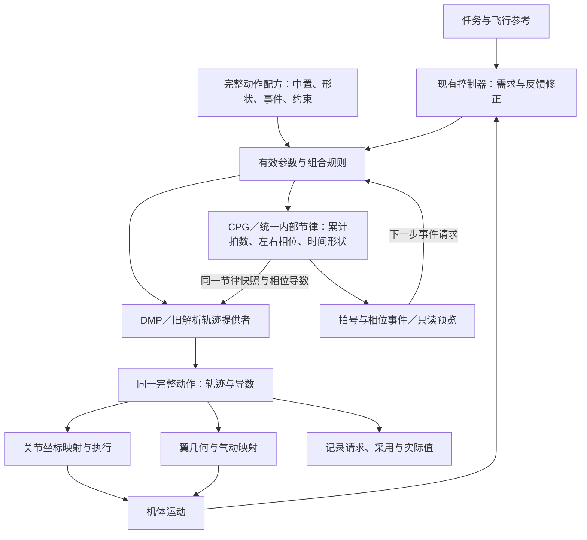

# 完整动作表达：现有资产、公式映射与合作放置

> Kula · 2026-10-13（Asia/Shanghai）  
> 本轮交付：动作表达定义、当前实现覆盖表、动态运动基元（DMP）与中央模式发生器（CPG）及现有控制器的合作方案。只读取资产和源码、编写 Markdown；不新增正式事项，不改控制代码，不运行仿真。  
> “已有”按具体变量、公式和消费者登记；“新增”是本次表达与接口设计，不要求先证明性能收益。当前代码常量与某次运行的实际配置分别看待。
> 本次补充：统一内部节律时基、`_tau_state`／Hopf／折翼计时的整合、左右差频与相位关系。下文“拟采用”均为文档设计，尚未接入控制代码。

**先给结论：已有中置上反必须作为资产保留。当前对应 `MEAN`／`BIAS` 与左右拍动关节的镜像目标，不能重新列为动作缺失。我们要增加的是覆盖全部作动坐标、时间形状、轨迹形状、组合规则和事件的共同表达，并让已有解析波形与真正的动态运动基元在同一出口合作。**

**节律补项：已有局部积分相位；需要增加的是统一内部节律服务。它管理累计拍数、各翼周期进度、拍内形状相位及它们之间的关系，整合现有相位资产，供拍动、扭转、折翼、DMP 和事件共同读取。统一推进权允许左右不同频率、不同相位，并不要求所有通道同相。**

## 1. 动作的物理基准：机体目标与九个作动坐标分开

当前配置使用 `fwav_15dof_from_group.urdf`，机构为浮动基座六自由度，加九个转动关节；早期“十五个全驱动关节”的生成器属于另一套资产，不作为这里的目录。[S1][S2]

动作出口的关节顺序在本文规定为：

$$
\mathbf q_d=
(q_{fL},q_{fR},q_{tL},q_{tR},q_{bL},q_{bR},q_{y},q_{eL},q_{eR})^{\mathsf T}.
$$

实际发送时按加载得到的 `joint_names` 映射，不依赖这段书写顺序。

| 作动组 | 当前关节名 | 当前机构轴 | 完整表达需要容纳的内容 |
| :--- | :--- | :--- | :--- |
| 左右翼拍动 | `flap_L`、`flap_R` | 各自局部 x 轴，左右目标有镜像符号 | **中置上反／行程中心**、幅值、任意声明的周期形状、时序、左右协调、保持与过渡。 |
| 左右翼俯仰／扭转 | `twist_L`、`twist_R` | 各自局部 y 轴 | 几何扭转角轨迹、中心、幅值、相对拍动的时序、左右独立形状；有效攻角由几何与来流映射另算。 |
| 左右翼折叠 | `fold_L`、`fold_R` | 各自局部 z 轴，左右限位镜像 | 折叠角轨迹、相位、幅值、保持姿态、展开／收拢过渡。 |
| 尾整体偏航 | `tail_yaw` | 局部 z 轴 | 方向舵角轨迹、配平值、反馈修正及过渡。 |
| 左右尾舵面 | `tail_L`、`tail_R` | 各自局部 y 轴 | 独立角轨迹；现有升降／副翼混合关系继续保留。 |

机构轴和限位由实际 URDF 定义。[S2] 机体位置、姿态、速度、角速度是飞行状态与控制目标，不额外伪装成六个直接作动关节。完整目录同时记录关节角色、轴、正方向、限位、单位和几何版本；不能将未映射的关节静默写成零。

## 2. 符号统一：先解除现有名称中的混用

| 本文符号 | 明确含义 | 当前对应 |
| :--- | :--- | :--- |
| `t` | 仿真物理时间，秒 | 驱动以 `step_count * PHYSICS_DT` 求值；控制器使用仿真时间。 |
| `χ_c / χ_i` | 集体／第 i 翼未回绕的累计周期预算，单位为拍 | **拟增加显式状态**；由有效周期预算频率积分。当前 `_tau_state` 每次取模，并未保存累计拍数。 |
| `τ_i / N_i` | 第 i 翼的周期进度／拍号 | 拟从 `χ_i` 派生；旧 `_tau_state` 对应局部回绕进度，固定相位偏移在其后另加。 |
| `Θ_i / θ_i / ν_i` | 未回绕形状相位／回绕形状相位／形状相位除以 `2π` 的未回绕坐标 | 旧 `_phase_sc` 返回 `θ_i=ph`；`Θ_i、ν_i` 拟补齐。旧 split 与光滑 H 的坐标变换分别声明。 |
| `φ_i` | 翼拍动角，弧度 | `evaluate()` 返回的 `phi`；**不是相位**。 |
| `μ_i` | 翼拍行程中心，按解剖／关节坐标映射明确 | `rad(MEAN + BIAS)`，包括已有中置上反的关节作动资产。 |
| `A_i` | 翼拍动单侧幅值，弧度 | `rad(AMPLITUDE)` 与幅值差动。 |
| `f_c / f_i` | 集体／每翼周期预算频率，赫兹 | 旧积分路径的有效频率；拟由它推进 `χ`。原生光滑后端下，它与瞬时形状相位速度分别记录。 |
| `f_H` | Hopf 瞬时相位增量换算出的频率，赫兹 | 当前 `wavegen_freq`；经选择后可成为旧积分路径的有效输入，不能再无标识地当作未经时间变形的预算频率。 |
| `ε / δ_0` | 左右差频累积量／右相对左的初始周期偏移，单位为拍 | 拟将 `dfreq` 积分为 `ε`；旧 `PHASE_OFFSET_LR` 的度数换为弧度再除以 `2π`，登记为 `δ_0`。 |
| `s_i` | 当前旧相位映射中正半相位区间的时间份额 | `SPLIT`；不自动等于任意轨迹的单调上／下扑时长。 |
| `ψ_i`／`lag_i` | 每翼俯仰相对拍动的相位偏移／时间滞后 | 波形族说明的 `psi`、`PITCH_LAG_S`、`dlag`。 |
| `Δphase_LR` | 左右拍动的相对相位，必须注明相位坐标 | `PHASE_OFFSET_LR` 在气动翼求值前加到周期分数；不等于右关节的镜像负号。 |
| `ρ_i`、`g_i` | 多拍执行密度、当前拍的执行门控 | `DUTY_MOD` 内部密度与 `gate_L/R`；与 `s_i` 分开。 |
| `w_i`、`ζ_i` | 动态运动基元的形状权重与内部状态 | **新增表达和实现位置**；不是旧参数的另一个名字。 |
| `ξ_fold,i` | 折翼程序实际读取的相位，弧度 | 当前是 `wk.omega*t+2.2`；拟明确选用周期预算相位或翼拍形状相位。 |

固定频率的标定关系 `ψ=2π f lag` 不能无条件代替当前不对称时基下的时间预览；左右频率不同还会持续改变相位差。完整动作必须写明采用哪一种时序定义。[S3][S4]

## 3. 现有公式链：它们已经放在哪里

### 3.1 相位积分与拍内时间形状

当前每个 `WingKinematics` 独立保存回绕相位，实际正常推进可写为：

$$
\widehat\tau_{i,k+1}=(\widehat\tau_{i,k}+f_{i,k}\Delta t)\bmod1,\qquad
\tau_i=\left(\widehat\tau_i+\frac{\delta_i}{2\pi}\right)\bmod1.
$$

`_tau_state` 对应 `τ̂_i`，`_t_prev` 保存上次推进时刻；第一次求值以 `(frequency*t)%1` 初始化。这里没有未回绕累计拍数。同一时刻重复求值不重复推进，俯仰滞后／超前求值用 `advance=False` 只读外推；停拍仍推进相位。`set_frequency()` 改速率而不重置相位。[S3]

旧分裂周期映射为：

$$
\theta_i=g_{s_i}(\tau_i)=
\begin{cases}
\pi\tau_i/s_i,&\tau_i<s_i,\\
\pi+\pi(\tau_i-s_i)/(1-s_i),&\tau_i\ge s_i.
\end{cases}
$$

这在源码中是先分配相位区间时间，再求角度形状。[S3] 对旧正弦，`s` 规定的是 `sin θ` 正半区间的时间份额；单调拍动方向还取决于 `cos θ`，不能把变量名直接当任意新动作的上下扑定义。新表达应允许显式相位分段与各段时间预算。

参考光滑相位资产则为：

$$
\dot\nu=\frac f{H(\nu)},\qquad
H(\nu)=1+b_1\sin(2\pi\nu)+b_3\sin(6\pi\nu).
$$

这里的 `ν` 对应参考代码的 `u=theta/(2π)`，是形状相位坐标，不能与旧积分器的等速周期进度混用。在其固定参数和有效剖面条件内，时间预算由 `H` 表示。[S4] 原生时基后端选择旧 `g_s` 或光滑 `H`；保留现有 Hopf→频率→旧 split 的兼容组合时，须另记为组合时序，不称为单一光滑后端。

### 3.2 已有中置上反与基础拍动

$$
\mu=\frac\pi{180}(\mathrm{MEAN}+\mathrm{BIAS}),\quad
A=\frac\pi{180}\mathrm{AMPLITUDE},\quad
\phi=\mu+A\sin\theta.
$$

当前源码常量为 `MEAN=19.8105°`、`BIAS=0°`、`AMPLITUDE=17.73°`。[S5] `FLAPPER_WAVE_MEAN` 在运动学对象构造前覆盖配置；关节和气动的运动学对象均读取中置并转成弧度，因此这是一项已有配置／构造路径资产。[S6]

令 `r(t)` 为当前启动斜坡，`d` 为幅值差动指令，现有关节表达是：

$$
q_{fL}=r\phi+d_j,\qquad q_{fR}=-r\phi+d_j,
\qquad
d_j=\begin{cases}d,&\text{旧偏置设置},\\d\sin\theta,&\text{幅值语义开关启用}.\end{cases}
$$

当前气动侧幅值命令为：

$$
A_L=rA+d,\qquad A_R=rA-d.
$$

所以已有中置、启动斜坡和差动都必须保留，且各自是什么操作要分开表达。[S7] 关节启动斜坡乘整个 `φ`，气动侧主要缩放幅值；不能在资产导入时暗中改成另一种斜坡。

**中置上反的坐标放置：**当前 URDF 拍动轴为 x，左右翼使用镜像目标；这给出了已有中置作动的关节基础。取中性扭转与折叠、相对翼根的一个翼展方向点作为简化示意，左右中置 `q_fL=+μ`、`q_fR=-μ` 给出：

$$
R_x(\mu)(0,\ell,0)=(0,\ell\cos\mu,\ell\sin\mu),\qquad
R_x(-\mu)(0,-\ell,0)=(0,-\ell\cos\mu,\ell\sin\mu).
$$

两侧翼展点均有向上的分量，这是已有中置上反的关节几何含义；完整机构仍按 URDF 的串联变换计算。中置是参考／行程中心，不等于不对称波形的周期时间平均。气动标准翼当前使用另一套几何公式：

$$
\mathbf r_b=\ell(\sin\phi,-\cos\phi,0)+\mathbf r_{root}.
$$

这条式子采用平面扫掠表示，不能把它与关节绕 x 轴的正向运动学默认为同一变换。[S2][S8] 完整表达保留已有中置上反，并为**关节角→翼几何姿态→气动坐标**登记明确映射；此处是在梳理表示位置，不将已有中置重新判为缺失，也不据此修改模型。

### 3.3 俯仰、折叠与尾舵

旧 `flip` 俯仰程序为：

$$
\alpha=a_b+a_A\cos\theta.
$$

旧 `aero` 俯仰程序为：

$$
\alpha(t)=a_b+\operatorname{sgn}(\dot\phi_{lag})\,
\alpha_{set}\lvert\cos\theta_{lag}\rvert,
\qquad \theta_{lag}=g_s(\tau^{preview}(t-lag)).
$$

滞后求值使用只读相位投影。[S3] 当前关节侧 `alpha_set_deg=12°`，气动侧 `ALPHA_SET=32.3169°`，是两套实际取值来源；记录时必须注明侧别和含义，不能仅因同名推定相等。[S5]

折叠及尾舵混合为：

$$
\beta(t)=r(t)\frac{a_{fold}}2[1+\sin(\omega t+2.2)],\quad
(q_{bL},q_{bR})=(\beta,-\beta),
$$

$$
\begin{bmatrix}q_{eL}\\q_{eR}\\q_y\end{bmatrix}=
\begin{bmatrix}1&1&0\\1&-1&0\\0&0&1\end{bmatrix}
\begin{bmatrix}elevator\\aileron\\rudder\end{bmatrix}.
$$

折叠目前是关节侧程序，时间参数直接使用 `ωt`；尾舵三通道已有关节与气动消费者。[S7][S9] 折翼拟接入统一时基的两种明确关系见 3.5.5；基础尾舵仍由控制器给定。无控制器时另有 `sin(ωt*0.5)` 的尾偏航程序，它同样属于周期时间程序资产，若接入时基应声明半拍频关系，不能把基础尾舵全部强制改成周期动作。

### 3.4 新拍频接入与既有五参数参考族

当前驱动已有 `select_effective_freq()`：默认采用名义 `freq`；开关启用且 `wavegen_freq` 有效时，采用其限幅后的值，并同步到气动集体拍频。[S10] 关节端当前先求值、后改频，新值在下一次求值使用；时间戳必须能表达这个生效边界。

参考族说明为 `(μ,A,f,s,ψ)`，但 `outputs_on_cycle()` 当前接收四参数 `(μ,A,f,s)`，其俯仰输出没有消费 `ψ`。控制器中的 Hopf 实现当前主要输出瞬时拍频，也不是整套五参数轨迹出口。[S4][S11] 这些数学和代码资产继续复用，分别注明实际输出范围。

### 3.5 统一内部节律时基：现有资产怎样整合

#### 3.5.1 共同节律状态与输出

**拟放置：有效参数装配之后、轨迹生成之前，由一个 CPG／相位服务推进。** 物理时间仍为 `t=step_count*PHYSICS_DT`；内部节律把它转换成动作的累计周期预算、拍号和形状相位。服务可管理多翼状态，所有关节、气动适配器、基元和事件读取同一版本快照。

先定义周期预算：

$$
\dot\chi_c=f_c,\qquad \dot\varepsilon=d_f,\qquad
\chi_L=\chi_c+\varepsilon,\quad
\chi_R=\chi_c-\varepsilon+\delta_0,
$$

$$
f_L=f_c+d_f,\qquad f_R=f_c-d_f,\qquad
N_i=\lfloor\chi_i\rfloor,\quad \tau_i=\chi_i-N_i.
$$

`f_c` 是该后端采用的有效预算频率，`d_f` 对应现有 `dfreq`，`δ_0` 是明确初始化的右对左周期偏移。默认 `ε(t0)=0`，接入点已有的左右进度差登记到 `δ_0`。每翼采用频率及约束结果均记录；若左右分别限幅，须用实际采用的 `f_L/f_R` 反算集体与差动，不能仍记录限幅前的 `f_c/d_f`。停拍门控与频率预算是不同维度，默认继承当前“停拍仍走时”语义。

拟定义的节律快照为：

$$
\mathcal X_{clk}(t)=
(t,t_{effective},version,backend,\chi_c,\varepsilon,
\{\chi_i,N_i,\tau_i,\Theta_i,\theta_i,\dot\Theta_i,\ddot\Theta_i\}_{i=L,R},
source,phase\_policy).
$$

**一处推进不等于一个标量描述全部动作。** 左右翼可以有不同进度，扭转和折翼可以读取不同的派生相位；推进、偏移、拍号和时间变形都由同一服务管理。`N_i` 在非等速时基下是周期预算拍号，形状完成拍号还可由 `floor(ν_i)` 登记；初始化时写明两者的零点。

#### 3.5.2 旧积分后端：保留 `_tau_state` 的数学资产

旧 split 后端直接用上述 `χ_i` 派生：

$$
\Theta_i=2\pi N_i+g_{s_i}(\tau_i),\qquad
\theta_i=\Theta_i\bmod2\pi,\qquad \nu_i=\Theta_i/(2\pi).
$$

在参数固定且远离分段边界时：

$$
\dot\Theta_i=g'_{s_i}(\tau_i)f_i.
$$

动态调整 `s_i` 时，还需要时间映射的参数导数；分段边界的速度变化也须按旧后端特性登记，采用光滑后端或明确过渡时再改变它。

| 当前资产 | 拟整合方式 | 保留的语义 |
| :--- | :--- | :--- |
| `_tau_state` | 积分逻辑升格为统一服务；总进度为 `χ_i mod1`，若保留原始状态读口则映射为 `(χ_i-δ_init,i) mod1` | 改频接续相位，累计拍数另存；原始进度与含初始偏移的总进度分开。 |
| `_t_prev` | 统一为主服务的已提交物理时刻 | 同一物理步只提交一次；各消费者不另改最后推进时刻。 |
| `_phase_sc / g_s` | 保留为旧 split 相位映射 | 正半相位区间的时间预算与角度形状分开。 |
| `evaluate / stroke_unit` | 拟读取同一节律快照，返回原有轨迹或归一化形状 | 读轨迹不再次走时，气动与关节不各自累积一份相位。 |
| 停拍与预览 | 门控决定轨迹是否执行；预览读取历史或副本 | 继承停拍继续推进的默认值；滞后、超前和周期平均不推进主状态。 |

迁入已有对象时，总进度对齐为 `χ_i(t0) mod1=(原_tau_state+δ_init,i) mod1`；其中 `δ_init,L=0、δ_init,R=δ_0`。仅凭回绕状态不能恢复以前走过几拍；有历史记录就恢复，没有记录就明确“从接入点重新编号”，不能伪造累计拍号。已有右翼 `phase_offset_lr` 只转入一次：读取总进度的轨迹端不再额外加它；兼容原始状态的适配器则先减回初始偏移，再沿旧接口加一次。

#### 3.5.3 Hopf：频率桥接资产与原生相位后端分开

现有控制器保存 `_wavegen_state=(sx,sy)`，先算：

$$
\vartheta_H=\operatorname{atan2}(sy,sx),\quad
\nu_H=\frac{\vartheta_H\bmod2\pi}{2\pi},\quad
\omega_H=\frac{2\pi\max(f_{nom},0.5)}{\max(H(\nu_H),0.1)}.
$$

然后推进振荡状态，按解缠的单步角度增量输出：

$$
f_H=\frac{\Delta\vartheta_H}{2\pi\Delta t}
\quad\longleftrightarrow\quad \texttt{wavegen\_freq}.
$$

当前生产实现每步先计算 `_rad/_w`，在该步各积分子阶段沿用；参考 `ltv/wavegen_family.py::hopf_step` 则在各子阶段重算半径与角度。这是已有实现版本差别，不能在文档迁入时宣称两者数值完全相同。[S4][S11]

| 接入方式 | 谁掌握动作相位 | 怎样使用已有变量 | 边界 |
| :--- | :--- | :--- | :--- |
| **兼容频率桥接** | 统一服务的旧积分后端掌握动作相位 | 保留 `wavegen_freq→select_effective_freq→f_c→χ_i→g_s`；Hopf 内部角度作为该频率来源的状态记录 | Hopf 角度不等于翼的形状相位；两段时间变形如现有配置同时启用，明确标为兼容组合。 |
| **原生 Hopf 后端** | 统一服务内的 Hopf 状态直接给出解缠 `Θ_i` | 预算输入为名义／有效 `f_i`；取 `ν_i=unwrap(atan2(y_i,x_i))/(2π)`、`Θ_i=2πν_i` | 不再将其 `f_H` 当新预算频率再积分并施加 H；旧 `g_s` 此时也不重复使用。 |

**拟整合顺序：先把兼容频率桥接纳入统一服务，再把原生 Hopf 作为可选择后端接到同一出口。** 原生接入时，控制器中的发生器职责归到 CPG；控制器继续提供速度预算和反馈需求，已有参数及频率选择规则作为适配资产保留。单翼或共模 Hopf 核不能自动宣称已经覆盖左右差频；拟由服务管理左右状态或明确的相位耦合关系。

原生光滑后端的时间关系为：

$$
\dot\nu_i=\frac{f_i}{H(\nu_i)},\qquad
\Theta_i=2\pi\nu_i,\qquad \dot\chi_i=f_i.
$$

这里 `χ_i` 记录周期时间预算，`ν_i` 记录形状走到哪里，两者同属一个服务的状态。固定 H 参数时，可用已有 `time_map` 对应的变换检验坐标关系：

$$
M_H(\nu)=\nu-\frac{b_1}{2\pi}(\cos2\pi\nu-1)
-\frac{b_3}{6\pi}(\cos6\pi\nu-1),\qquad
M_H(\nu_i(t))-M_H(\nu_i(t_0))=\chi_i(t)-\chi_i(t_0).
$$

H 参数随时间改变时，按后端动力学连续推进并记录版本，不能继续把固定参数的坐标等式当作无条件恒等式。频率被限幅或回退时，采用值必须作用到相位后端的实际推进；不能仅限幅报告出的 `f_H`，轨迹却继续读未经限幅的 Hopf 角度。切换后端时先对齐累计进度、形状相位与零点，必要时显式过渡，不能直接把一个后端的周期分数当作另一个的相位。

Hopf 半径 `r_H=hypot(x,y)` 是振荡器内部状态，当前并未直接形成翼拍幅值指令。完整动作的空间幅值 `A_i` 仍由动作参数装配给定；将 `r_H` 映射成物理幅值需要另列映射与控制权，不能把内部径向吸引性直接写成机体或实际翼幅恢复。

#### 3.5.4 左右差频、初始相差与锁相

沿用现有符号方向 `f_L=f_c+dfreq、f_R=f_c-dfreq`，右对左的周期差为：

$$
\Delta\chi_{R-L}=\chi_R-\chi_L
=\delta_0-2\int_{t_0}^{t}d_f(\xi)\,d\xi,\qquad
\frac{d}{dt}\Delta\chi_{R-L}=-2d_f.
$$

相应预算角度差的速度为 `-4π dfreq`。例如 `dfreq=0.1 Hz` 保持 1 秒，右对左的预算角度差减少 `0.2 拍=72°`；这只是上述关系的算例，不是新增仿真结果。

| 时序要求 | 放置变量与规则 | 对现有资产的含义 |
| :--- | :--- | :--- |
| 初始左右周期相差 | `δ_0=rad(PHASE_OFFSET_LR)/(2π)`，写明初始化时刻 | 旧偏移在 split 之前加入周期进度，按同一坐标导入。 |
| 持续左右差频 | `dfreq→ε̇→χ_L/χ_R` | 积分改变相差；关节、气动和记录拟读取相同的各翼时序。 |
| 固定左右形状相差 | 在 `Θ_R-Θ_L` 坐标声明目标，由相位耦合／锁相规则调整实际推进 | 与固定周期进度差分别表达；有 split/H 时二者通常不同。 |
| 固定周期进度差 | 保持 `χ_R-χ_L` 的目标；稳态采用零预算差频或耦合纠偏 | 不能同时要求任意持续非零差频和永久固定的同坐标相差。 |
| 俯仰相对拍动 | 每翼 `lag_i(t)` 或已注明坐标的 `ψ_i(t)` | 不占用左右相差字段；时间滞后按该翼相位历史／预览求值。 |
| 左右关节镜像 | 坐标映射层的符号和机构变换 | 同步拍动时 `q_fL=+φ_L、q_fR=-φ_R`；负号不能作为 `π` 相差。 |

如果要求锁相，`dfreq` 可作为纠偏需求，耦合项在 CPG 内决定实际采用速率，结果单独记录。控制器请求、CPG 采用频差和最终形状相差不能合并成一个字段。时间滞后与固定相位偏移也分别保存：变频／不对称时序下，`ψ=2πf·lag` 不是通用替代式。

#### 3.5.5 折翼怎样接入：先声明它跟随哪一个时间坐标

当前 `ξ_fold=ω(t)t+2.2`。定频时它等于从零点开始的等速相位；变频时，`ω(t)t` 一般不等于 `∫ω dt`。拟保留原折翼形状与启动斜坡，将其计时依赖明确为下列配方之一：

| 配方 | 拟采用相位 | 适用含义 |
| :--- | :--- | :--- |
| **周期预算关联：优先导入关系** | `ξ_fold,i=2πχ_parent(i)+β_0,i`，原偏置 `β_0=2.2 rad` | 先按现有共模程序让两侧都读取 `χ_c`，定频且零点对齐时对应原公式。若配方要求折翼跟随各翼差频，再显式选 `χ_L/χ_R`；旧 split 不额外改变折翼拍内时序。 |
| **翼拍形状锁定：显式新配方** | `ξ_fold,i=Θ_i+β_0,i` | 折翼跟随翼拍的分裂／光滑形状相位；它会改变原来的相对时序，不能称为无行为变化的导入。 |
| **旧时间程序适配** | `ξ_fold=wk.omega*t+2.2` | 初次接口接入若保留当前行为，登记为旧程序，随后按授权切换上述关系。 |

折翼轨迹出口保持：

$$
\beta_i=r(t)\frac{a_{fold,i}}2[1+\sin\xi_{fold,i}],
\qquad q_{bL}=+\beta_L,\quad q_{bR}=-\beta_R.
$$

周期预算关联时 `ξ̇_fold,i=2πf_parent(i)`；形状锁定时 `ξ̇_fold,i=Θ̇_i`。父时序及其零点写入配方，已有共模折翼和新增各翼时序不混同。中心、幅值、斜坡和相位共同生成轨迹导数，不仅更换正弦中的一个名字。折翼基元今后也可读取同一坐标；统一时基本身不限制其轨迹形状。

#### 3.5.6 推进、生效、预览和事件的共同纪律

1. **一次提交，共同读取。** 每个物理步由服务推进并发布一个节律版本；关节、气动、DMP、记录与事件读取该版本。DMP 变换状态按物理步更新，读取几次不更新几次。
2. **实际生效时刻明确。** 当前关节先求值、后设置新频率；兼容路径保留该次序并记录下一次求值生效。未来采用“先装配再推进”时列为明确接入变化，不能悄悄抹平原先的时序。
3. **历史与预览只读。** 当前 `advance=False` 用已存相位和当前频率做线性外推，尚不等于完整频率历史。拟由服务提供相位历史、未来调度副本或注明假设的只读外推；气动周期平均求值也只推进副本，不能消耗真实拍号。
4. **拍号驱动事件。** 停拍密度、单拍门控和指定相位触发可以读取共同拍号；左右差频时写明用集体还是某翼拍号。现有控制器给出的门控先作为明确输入接入，不冒称已经改用该服务。
5. **门控与节律策略分开。** 默认继承停拍继续走时；冻结、重新起拍、相位重置和过渡另列配方策略。参数改动默认接续相位；显式重置则记录新节律段号、原因及过渡，不隐藏在发生器初始化中。

## 4. 完整动作定义：配方与当步轨迹两层

### 4.1 动作配方：表达“是什么动作，以及谁可以调它”

$$
\mathcal R=(id,version,\mathcal J,\Gamma_a,m,\mathcal T,\mathbf p_0,
\mathbf w,\zeta_0,\mathcal E,\mathcal C,\mathcal K,\mathcal O).
$$

| 字段 | 必须表达的内容 | 从现有资产怎样增加 |
| :--- | :--- | :--- |
| `id/version` | 动作族、配方及参数版本 | 将分散的配置、波形、控制修正和事件归到同一配方；不另建正式事项系统。 |
| `J` | 九个作动坐标的目录、单位、轴、限位、控制方式、角色 | 从当前机构文件与加载器取得；固定、主动、保持、未支持都明确标记。 |
| `Γ_a` | 动作参考轨迹或轨迹族 | 覆盖所有翼与尾舵通道；与飞行目标 `Γ_f` 分开。这里不直接宣称整机不变性。 |
| `m` | 翼工作体制及当前动作段 | 扑动、保持、停拍、复拍等；任务阶段和飞行运动族另列。 |
| `T` | 节律后端、累计周期预算、拍号、各翼相位及坐标类型、差频／相差、重置与过渡策略 | 对应 3.5 的共同节律服务及 `X_clk`；旧积分、split、Hopf、折翼计时作为有名资产整合，规定唯一推进者。 |
| `p0` | 每通道基准中心、幅值、俯仰／折叠参数、尾舵配平与反馈入口 | **已有中置上反直接纳入**；允许明确左右独立中心和动态修正，不限于一个共模标量。 |
| `w/ζ0` | 基元形状权重、示教／采样来源、内部状态初值，以及形状中心和幅值的归一化约定 | 新增真正的动态运动基元；旧解析轨迹同样可以导入共同出口。 |
| `E` | 停拍／复拍、构型变化、触发相位、保持姿态和过渡程序 | 导入既有闸门与事件语义；不能把幅值为零、密度为零和滑翔事件混同。 |
| `C` | 行程、速度、力矩、变化率、组合与过渡约束 | 从机构与当前配置导入，记录哪个约束在何处处理。 |
| `K` | 解剖角／关节角／翼几何／气动坐标的变换和几何版本 | 明确镜像符号、参考轴、翼根和折叠几何；不同模型近似有不同标识。 |
| `O` | 每个参数的职责、控制权与组合操作 | 规定谁给基准、谁给反馈修正，哪些用加法、乘法、相位变形或事件覆盖。 |

完整性基准是**声明的机械自由度＋各自由度的轨迹＋时序与过渡＋组合与坐标语义**。用更多轨迹形状直接扩展表达，不等待性能比较决定是否容纳；有限的旧参数字典不定义整个动作空间。

### 4.2 当步动作：表达“这次究竟生成和采用了什么”

$$
\mathcal A(t)=(t,t_{effective},version,m,\mathbf p_{requested},
\mathbf p_{effective},\mathcal X_{clk},
\mathbf q_d,\dot{\mathbf q}_d,\ddot{\mathbf q}_d,
\mathcal E_{active},\mathcal K,\mathcal C_{active}).
$$

该对象覆盖九个关节，每项的状态为主动生成、保持、被动或未支持之一。请求值、采用值和实际测量值分别保存；未支持不能默认为零，也不能与“明确要求零”混同。气动采用目标运动学、实测运动学或旧模型程序时，都注明来源，避免把不同运动当成同一动作。

现有单一 `φ/α`、两个模型侧翼状态、尾舵混合与记录缓存，汇入这个当步动作；增加的是共同出口和来源，不是重新发现已有通道。`X_clk` 引用该物理步的节律快照，包含相位及导数；动作对象的各读者不因求值而重新推进节律。

## 5. 轨迹表达：旧正弦怎样成为基元接口的一个实例

在共同的解剖／关节坐标定义下，每项轨迹可统一装配为：

$$
q_i^d(t)=\mu_i(t)+a_i(t)z_i(t)+\delta q_i(t),
$$

其中 `μ_i` 为中心，`a_i` 为幅值或缩放量，`z_i` 是归一化形状输出，`δq_i` 是明确授权给反馈层的加性轨迹修正；最终再做已声明的镜像与坐标映射。并非每个通道都必须使用每一项，使用情况写进配方。

| 形状来源 | `z_i` 怎样产生 | 与当前公式的关系 |
| :--- | :--- | :--- |
| 旧解析拍动 | `sin θ_i` | 现有 `μ+A sin θ` 原样成为一种形状实现。 |
| 旧解析俯仰 | `cos θ_i` 或现有滞后俯仰程序 | 保留 `flip/aero` 两类资产及其参数；时间滞后与相位偏移明确区分。 |
| 旧折叠／尾舵程序 | 现有时间函数、保持值或控制器参考 | 可以先原样导入，随后由明确的相位／过渡程序承接。 |
| 动态运动基元 | 内部轨迹状态受相位相关形状驱动项推进 | **新增真正的基元状态与形状表达**；不是把正弦改名。可由解析、采样或示教动作初始化。 |

一类节律基元可用以下结构说明新增量；这是拟加入层的结构式，不是现有代码：

$$
T_D\dot z_i=v_i,\qquad
T_D\dot v_i=-k_i z_i-d_i v_i+F_i(\theta_i;\mathbf w_i)+c_i,
$$

$$
F_i(\theta_i;\mathbf w_i)=
\frac{\sum_k w_{ik}\Psi_k(\theta_i)}{\sum_k\Psi_k(\theta_i)}.
$$

`w` 控制轨迹形状，`ζ=(z,v)` 保存基元内部状态，`T_D` 是时间尺度，`c_i` 是明确的耦合或反馈入口。时间尺度须与相位服务协同；周期基函数、维数与学习方式可以扩展，不由当前正弦族封顶。基元用动态系统生成多自由度轨迹、各自由度共享规范相位的依据见[动态运动基元研究][T1]。

当中心和幅值也随时间变化时，完整导数应包含：

$$
\dot q_i^d=\dot\mu_i+\dot a_i z_i+a_i\dot z_i+\delta\dot q_i,
$$

$$
\ddot q_i^d=\ddot\mu_i+\ddot a_i z_i+2\dot a_i\dot z_i
+a_i\ddot z_i+\delta\ddot q_i.
$$

相位、参数调度、过渡和反馈共同产生这些导数，不能沿用固定参数公式后仍称完整轨迹。这是表达层应承担的内容，非额外飞行性能门槛。

### 5.1 DMP 怎样随共同节律走时

**CPG 给出规范相位及其速度；DMP 保留轨迹内部状态并生成形状。** 每个基元在配方中声明它读取哪一翼、哪一种坐标及哪个相对偏移。拍动、扭转和折翼可以共享节律而使用不同权重，也可以读取明确派生的相位关系；已有中置 `μ_i` 和幅值 `a_i` 继续由动作装配管理。

一种拟采用的同步实现，是在选定的未回绕形状坐标 `ν_i=Θ_i/(2π)` 上定义变换系统。令：

$$
G_i=-k_i z_i-d_i v_i+F_i(\theta_i;\mathbf w_i)+c_i,\qquad
\frac{dz_i}{d\nu_i}=v_i,\quad \frac{dv_i}{d\nu_i}=G_i.
$$

物理时间下共同推进：

$$
\dot z_i=\dot\nu_i v_i,\qquad
\dot v_i=\dot\nu_i G_i,\qquad
\ddot z_i=\ddot\nu_i v_i+\dot\nu_i^2G_i.
$$

当 `ν̇_i>0` 时，前述结构中的时间尺度取 `T_D,i=1/ν̇_i`，两种写法对应同一变换状态；其速度预算和时间变形来自 CPG。它不再自行积分一份 `f*t` 或独立相位，也不再对已变形的相位重复做 split/H。另一种 DMP 实现如果按物理时间定义耦合和状态，也必须明确同一相位输入与时间尺度关系，不能只说“共用频率”。

若配方选择冻结相位，这种实现中的 `z_i/v_i` 随之冻结，保持／过渡轨迹由已声明的程序处理；当前默认停拍继续走时则由门控决定采用保持还是基元输出，不能自动把停拍等同于基元清零。周期回绕只影响周期基函数的求值，不重置 DMP 内部状态。

## 6. 现有实现覆盖表：变量、变换、消费者、需要增加什么

| 资产／变量 | 已有变换和消费者 | 覆盖范围 | 在完整表达中增加什么 |
| :--- | :--- | :--- | :--- |
| **中置上反：`MEAN/BIAS`** | 环境覆盖→配置→弧度→`φ=μ+A sin θ`→左右镜像目标；气动两翼构造也读取 mean。[S3][S6][S7] | 已有配置／构造消费。十二键 `commands['mean']` 未在当前生产驱动发现动态消费；独立学习环境有模型侧 mean。[S12][S13] | 保留基准 `μ`；增加左右及动态 `μ_i(t)` 的统一参数入口、职责和几何坐标映射。 |
| **集体幅值：`AMPLITUDE`** | 当前关节对象显式读取 `WING_DRIVE_CONFIG.amplitude_deg`；气动对象及环境补推有另一来源。[S5][S6][S14] | 固定基础幅值已有；覆盖来源分侧。 | 共用基准／有效幅值说明；`amp_frac` 的乘法作用落实到完整轨迹入口。 |
| **幅值差动：`dA`** | 气动 `A_L=rA+dA`、`A_R=rA-dA`；关节按已有开关选角偏置或 `dA sin θ`。[S7] | 有消费者，操作含义由设置决定。 | 旧偏置与幅值差采用不同语义字段；组合后只形成一份明确轨迹。 |
| **名义／有效拍频** | 控制器 `freq` 与 `wavegen_freq`→选择函数→关节下一次求值与气动集体同步。[S10][S11] | 原频率主链已有；Hopf 输出条件接入。 | 统一相位服务与生效时间；保留名义、采用、限幅、回退的来源。 |
| **局部积分相位：`_tau_state/_t_prev`** | 各 `WingKinematics` 独立积分并取模；预览只读，停拍继续推进。[S3][S15] | 局部节律已有，未回绕拍数与统一快照未覆盖。 | 共同 `χ/N/τ/Θ` 状态与唯一提交者；旧相位读口作为适配资产。 |
| **Hopf：`_wavegen_state/wavegen_freq`** | 振荡状态→单步相位增量→瞬时频率→条件消费。[S4][S10][S11] | 振荡器资产已有，尚非全部通道的相位来源。 | 兼容频率桥接与原生相位后端分别登记；相位后端的限幅、切换和左右耦合在 CPG 管理。 |
| **差频：`dfreq`** | 气动左右频率设为 `f_eff±dfreq`；关节侧仍共用一个 `wk`。[S7] | 模型侧已有，关节独立时基未覆盖。 | `ε̇=dfreq、χ_L/R=χ_c±ε`，初始相差另加；各消费者采用同一每翼时序。 |
| **拍内时间分配：`SPLIT`** | 构造读入→分段相位 `g_s`；参考族另有光滑 `H`。[S3][S4][S6] | 配置时基资产已有；当前控制器无动态 split 输出。 | 时间形状提供者、显式相位段和参数调度；一种路径只进行一次时间变形。 |
| **翼俯仰及 `lag/dlag`** | 两类俯仰程序已有；dlag 改气动左右滞后，关节 twist 仍共用基础 α。[S3][S7] | 基础程序已有，左右动态滞后主要模型侧。 | 每翼扭转角的独立形状与相对时序，统一到同一关节／几何出口。 |
| **左右相位差** | 气动右翼求值使用 `phase_offset_lr`；关节左右仍按共模镜像。[S15] | 模型配置和接口已有。 | split 前的 `δ_0`、形状相位差目标与锁相规则分开；持续差频导致相差累积。 |
| **拍密度与 `gate_L/R`** | 控制器逐拍分支→气动门控；气动停拍返回中置与零运动导数。[S3][S7][S16] | 逐拍模型侧机制已有；关节门控与连续 `duty` 不能由此推定已覆盖。 | 密度、当前拍门控、保持姿态、模式事件与过渡各有明确字段。 |
| **折叠 `fold`** | `sin(wk.omega*t+2.2)`→左右镜像关节目标，当前气动标准翼状态没有 fold 字段。[S7][S8] | 关节程序已有，计时未读取积分相位。 | 优先导入共模 `2πχ_c+2.2`；跟随各翼 `χ_i` 或读取 `Θ_i+2.2` 的关系另列配方。保留形状、斜坡和几何映射。 |
| **尾舵 `elevator/aileron/rudder`** | 现有线性混合到三尾关节，同时传入尾翼气动。[S7][S9] | 两侧已有消费者。 | 保留控制器职责；动作对象完整包含尾舵轨迹、配平与过渡。 |
| **五参数波形族** | 相位核与正弦／余弦输出映射；函数实际输入未覆盖说明中的全部 ψ。[S4] | 数学与代码资产存在，接口范围明确。 | 导入解析后端与参数词典；DMP 以形状权重及内部态扩展轨迹。 |
| **十二键指令契约** | 核心九键加 `mean/amp_frac/duty` 的命名、默认和单位。[S12] | 指令词典已有，不能替代消费者覆盖表。 | 将配方、时基、形状、事件、轨迹、坐标与来源补成完整对象；旧键成为适配输入。 |
| **关节目标字典与记录** | 当前发送九个目标；按 joint_names 排序，未命名项采用零；已有原值及缓存。[S7][S17] | 目标和记录资产已有。 | 全目录显式覆盖；记录每项请求、采用与测量，未支持不静默归零。 |

## 7. DMP、CPG 与现有控制器：各自接在哪一层

| 部件 | 负责的输入与输出 | 现有位置 | 拟放置／合作方式 |
| :--- | :--- | :--- | :--- |
| **任务与飞行参考** | 高度、速度、坡度、路径等目标及翼工作体制 | 当前 TECS 与航向／坡度参考分支 | 继续给飞行控制需求；与动作族 `Γ_a` 建立明确联系，不直接逐帧写关节。 |
| **现有控制器** | 机体反馈→速度预算、差动需求、参数修正和尾舵参考 | `FlightController.update`、现有尾舵和差动分配；Hopf 当前也在此函数内 | 保留 `freq/dfreq/dA/dlag/gate/elevator/aileron/rudder` 等需求；拟由 CPG 接手发生器走时职责。控制器不各自推进翼相位或 DMP 状态。新增参数控制权另登。 |
| **动作参数装配** | 基准配方＋反馈修正＋事件＋约束→有效参数与节律策略 | 当前分散在配置、控制器及 `_drive_wing_joints` | 复用有效频率选择，明确 `f_c/d_f/δ_0/s/H` 的坐标、后端、采用值和生效时刻；中置、幅值、混合与门控也在此组合。 |
| **CPG／统一内部节律服务** | 有效速度预算＋相位关系／耦合→`X_clk` | `_tau_state/_phase_sc`、Hopf 核、有效拍频选择及当前折翼计时 | 唯一推进、提交 `χ/N/τ/Θ` 与导数；管理左右差频、相差、锁相、预览和切换。旧积分与原生 Hopf 后端用同一出口。 |
| **DMP／轨迹形状** | `X_clk`＋形状权重＋基元状态＋明确反馈耦合→轨迹及导数 | 当前主要由 `WingKinematics.evaluate` 内的解析式承担 | 变换状态按共同相位／时间尺度更新，权重表达轨迹形状；旧解析式与真正 DMP 作为同接口形状资产合作。基础中心／幅值由装配层给定。 |
| **关节／气动坐标映射** | 完整轨迹→各消费者需要的关节目标、翼姿态和运动学 | 当前 target 字典、左右镜像、模型内翼几何 | 明确中置、扭转、折叠等的正向运动学与气动映射；保留旧模型近似作为具名后端。 |
| **执行与气动消费者** | 同一版本的动作→关节驱动、气动力求值与记录 | `_drive_wing_joints`、`compute_forces`、记录器 | 共用时间、相位、参数和轨迹来源；周期平均预览只读其状态副本，不推进真实动作时钟。 |

### 合作规则

1. **一份基准、一套明确修正。** 例如中心用 `μ=μ0+δμ`；幅值缩放与左右差动分别写出；尾舵保留现有混合。不能将两条完整轨迹任意相加后称为合作。
2. **一个节律推进权威，多项明确派生关系。** CPG 管理共同周期预算、每翼进度、相位及差频／锁相。动态运动基元保留轨迹内部状态，按共同节律推进；折翼、俯仰与事件读取已声明的时间坐标。
3. **时间形状与角度形状分别表达。** split／慢度决定在相位区间花多少时间，基元权重决定该相位下走什么轨迹；连续变形时导数和过渡共同生成。
4. **连续控制与事件分别表达。** 频率、幅值、中心等连续参数与停拍、复拍、保持姿态事件并列；密度零不自动改成另一工作体制。
5. **约束后仍保留原请求。** 采用值可以受约束改变，但输出原请求、采用值及原因，不能悄悄吞掉表达能力。
6. **合作边界以变量为单位。** 每个变量登记基准提供者、反馈修正者、最终采用者和事件优先规则；完整表达可以立即覆盖全部坐标，工程接入按已明确的变量范围逐步进行。

三者职责可直接表述为：**控制器决定速度预算及动作要如何调整；CPG 决定动作走到第几拍、哪个相位及通道之间怎样协调；DMP 决定沿这些相位走什么轨迹。** 中置上反是动作中心资产，幅值是空间缩放，节律是时间关系，三者在装配和生成时合作。

## 8. 需要增加的资产与具体放置位置

| 要增加什么 | 相当于当前什么位置 | 拟增加的内容 | 已有资产怎样保留 |
| :--- | :--- | :--- | :--- |
| **完整作动目录** | 当前 URDF、joint_names 与 target 字典之间 | 机械坐标、轴、映射、单位、角色、约束及完整覆盖声明 | 九关节和加载器直接复用，旧十五全驱动样机另标资产版本。 |
| **动作配方与当步动作对象** | 当前波形配置＋控制器输出字典＋各缓存 | 全量基准、时基、形状、事件、轨迹、来源、控制权和有效值 | 中置上反、幅值、相位程序、尾舵和闸门都导入，不另起一个不相容指令系统。 |
| **动态参数统一入口** | 配置／构造参数与运行时消费之间 | 每翼 `μ_i(t)`、幅值、俯仰／折叠参数和相位坐标的明确消费者 | 已有配置入口继续可用，动态接口范围另列；不把“静态已有”误写成“动态全有”。 |
| **真正的动态运动基元** | 当前 `evaluate` 中的形状公式位置 | 形状权重、内部状态、周期／单次动作与输出导数，及解析／采样／示教导入 | 当前正弦、俯仰程序和折叠程序是可用形状资产，同接口合作。 |
| **统一内部节律服务** | 当前多个 `_tau_state`、控制器 Hopf、频率选择与折翼 `ωt` 之间 | `χ/N/τ/Θ` 快照、左右差频积分、相位坐标、时间后端、锁相与推进／预览规则 | 旧积分核保留，Hopf 先兼容桥接再作可选原生后端；原形状保留，折翼计时关系显式选择。 |
| **完整几何映射** | target 镜像与模型 `_wing_forces` 几何之间 | 中置上反、扭转、折叠轨迹到翼姿态、位置与速度的明确变换 | 保留旧关节和模型公式为具名适配器，不偷偷改参数或物理行为。 |
| **统一轨迹装配与事件过渡** | 当前驱动函数中的分散混合和门控 | 控制器修正、保持姿态、恢复轨迹、限幅、变化率与有效输出 | 尾舵职责、启动斜坡和现有事件分别登记；首次合作边界可逐变量限定。 |
| **动作来源与采用记录** | 当前控制器快照、翼状态缓存和原值记录 | 同一动作版本的请求、有效轨迹、关节测量和气动采用值 | 复用已有记录设施，增加表达所需字段，不重新组织一套任务账本。 |

本次增加项是完整表达、轨迹生成与合作放置的设计内容。无需先证明新方法更值得，才允许它们进入表达；后续实际接入产生的行为再用于改进组合、消费者和控制分配。

## 9. 依据入口

本表按当前代码消费者和公式核实。机械资产常量是源码配置值，不代替某次运行的实际采用值；未读取云端事项状态，也不以旧报告的关闭状态推定实现。

[S1]: G:/Playground/isaac_flapper_sim/config/sim_config.py:31 "当前机构来源与自由度分配"
[S2]: G:/Playground/isaac_flapper_sim/assets/flapper/fwav_15dof_from_group.urdf:47 "实际九关节轴和限位"
[S3]: G:/Playground/isaac_flapper_sim/modules/aero/kinematics.py:36 "参数单位、相位及轨迹公式"
[S4]: G:/Playground/isaac_flapper_sim/ltv/wavegen_family.py:55 "光滑相位和实际参考输出映射"
[S5]: G:/Playground/isaac_flapper_sim/config/sim_config.py:66 "关节驱动配置；波形配置在 187 行起"
[S6]: G:/Playground/isaac_flapper_sim/modules/sim_env_bridge.py:74 "配置覆盖及气动幅值补推"
[S7]: G:/Playground/isaac_flapper_sim/modules/wing_actuation.py:103 "轨迹装配、模型注入与九关节目标"
[S8]: G:/Playground/isaac_flapper_sim/modules/aero/sane_dickinson_3d.py:68 "气动标准翼几何公式"
[S9]: G:/Playground/isaac_flapper_sim/modules/aero/tail_fuselage.py:35 "尾舵控制与力矩计算"
[S10]: G:/Playground/isaac_flapper_sim/modules/wing_actuation.py:39 "有效拍频选择"
[S11]: G:/Playground/isaac_flapper_sim/modules/flight_controller.py:1275 "当前 Hopf 与控制器返回"
[S12]: G:/Playground/isaac_flapper_sim/modules/contracts.py:95 "现有十二键指令契约"
[S13]: G:/Playground/isaac_flapper_sim/rl/hover_env_v2.py:171 "独立学习环境的模型侧 mean"
[S14]: G:/Playground/isaac_flapper_sim/main_sim.py:561 "关节运动学对象实际构造参数"
[S15]: G:/Playground/isaac_flapper_sim/modules/aero/sane_dickinson.py:336 "两翼相位求值及运行时参数接口"
[S16]: G:/Playground/isaac_flapper_sim/modules/flight_controller.py:1140 "现有逐拍密度和门控生成"
[S17]: G:/Playground/isaac_flapper_sim/modules/fw_iid_ledger.py:84 "已有原值与关节通道记录"
[T1]: https://www.frontiersin.org/journals/computational-neuroscience/articles/10.3389/fncom.2013.00138/full "多自由度动态运动基元、周期形状驱动与共享相位"
