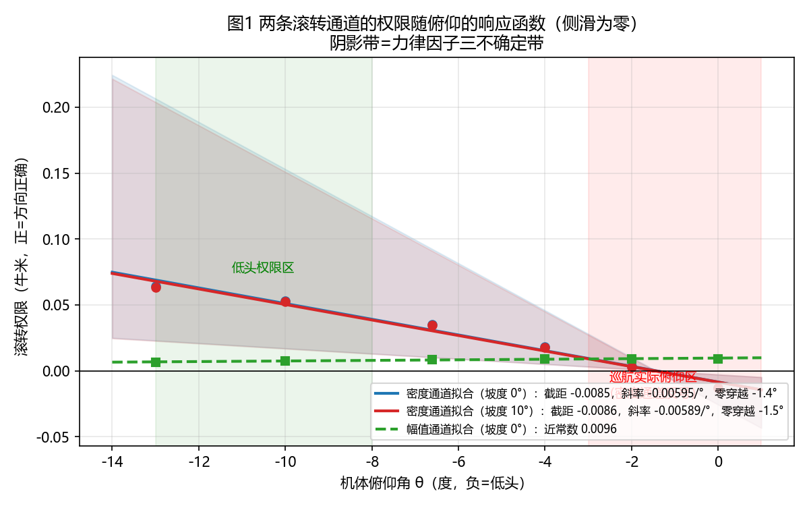
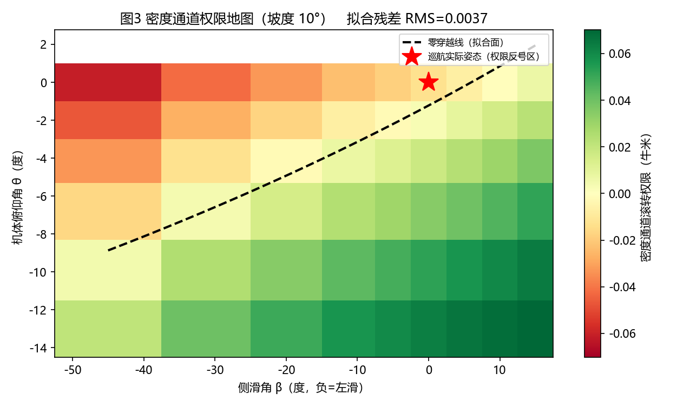
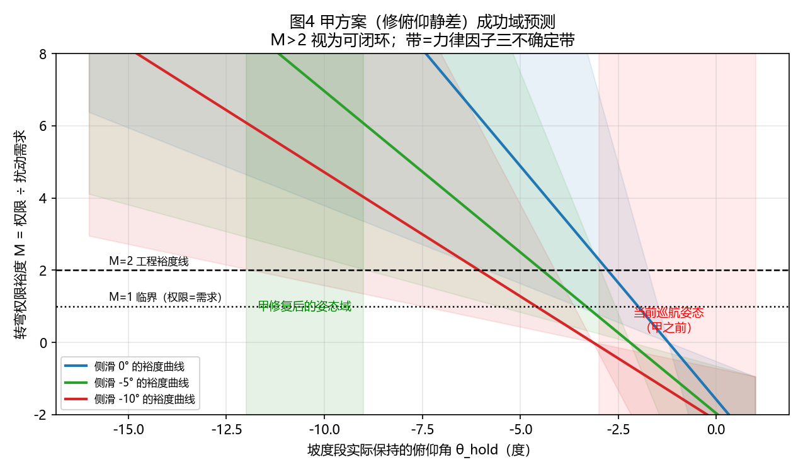

# 权限响应函数与甲方案预测（2026-09-28，整改纪律首次执行）

本文件是《工作方式整改_函数化与可视化纪律.md》第一条的首次交付：
全部结论以响应函数与图给出，数字只出现在拟合系数与图中。
工具：tools/authority_response_grid.py（测量）、
tools/authority_fit_figs.py（拟合与绘图）。
数据：logs/authority_response_grid_phi0.json、phi10.json、
logs/authority_fits.json。

## 一、密度通道权限的响应函数

以俯仰角 θ 与侧滑角 β（单位均为度）为自变量、坡度 φ 为分档的二元
线性加交互项拟合：

A(θ, β, φ) = c0 + cθ·θ + cβ·β + cθβ·θ·β

系数与残差在 logs/authority_fits.json，两个坡度档的残差 RMS 均为
权限满额量级的百分之六以内，二元线性加交互项对该曲面够用。
标度律：权限对俯仰的敏感度约为对侧滑的六至十八倍（按单位角度），
俯仰是第一自变量，侧滑是第二自变量——这与"侧滑是权限杀手"的
旧归因（已作废）在函数形态上划清界限。

零穿越线：θ*(β, φ) = −(c0 + cβ·β) / (cθ + cθβ·β)。在侧滑为零处
θ* 约为负一点四度（此前按稀疏切片估计的负四度作废，门控参数保持
负四度与负六度的保守取值不改，作为不确定带内的缓冲）。

## 二、权限地图（转弯工况）

地图读法：绿色为正权限，红色为反号，黑色虚线为零穿越。巡航实际
姿态（红星）落在反号区边缘。向左下方移动（低头、适量左滑）权限
增大。平飞档地图见 docs/figs/fig2_权限地图_坡度0.png。

## 三、幅值通道的响应函数

A_dA(θ) 近似常数，斜率项接近零：该通道对俯仰不敏感，量级为密度
通道低头区的六分之一上下。函数形态决定分工：它是巡航姿态附近的
恒正细调通道，不是转弯主力通道。

## 四、甲方案成功域预测（先图后试验）

裕度定义：M(θ_hold, β) = A(θ_hold, β, φ=10°) / D(10°, β)，其中
转弯扰动需求函数 D(φ, β) = 4.4e-4·|φ| + 4.2e-4·|β|（牛米，角度
单位度；系数来自第七十一班实测的坡度伴生侧滑驱动矩与侧滑整流
梯度）。M 大于一表示权限覆盖需求，工程裕度线取二。

预测结论：裕度曲线随保持俯仰角单调上升，在侧滑走廊代表值下，
保持俯仰低于约负五至负七度进入 M 大于二区域；当前巡航姿态
（俯仰零度附近）M 小于一，即权限不覆盖需求，与三次在环失败
一致。甲方案（修复俯仰环稳态误差，使实际俯仰跟随指令进入
负十度邻域）的预测是成功域可达，且在力律因子三不确定带的
下边界仍保有裕度。

预测成立的三个前提（显式登记）：其一，俯仰环修复后实际俯仰
能稳定保持在目标值附近，暂态超调不越过零穿越线；其二，横向
小信号阻尼由幅值差动共存规则恢复（已在库）；其三，切入瞬态的
高度损失在判据三容限内——该风险点随俯仰加深而增大，是甲方案
的主要代价项。

## 五、什么是俯仰环稳态误差（函数化表述）

俯仰环的设计响应函数是"实际俯仰等于指令俯仰"。实测响应函数是
"实际俯仰等于指令俯仰加一个正常数偏移"：巡航指令约负八度，
实际约零度，偏移约八度。该偏移的已知来源是积分门与稳态误差的
匹配缺陷（第四十四轮登记：稳态误差大于积分门限时积分器全程
关断，环路只剩比例项，比例项必须留静差）。甲方案的内容就是
把这个偏移函数修回零偏移，不涉及任何内部分配问题——机主需要
决定的只是"是否允许为修这个偏移改动已验收的巡航配置"。
